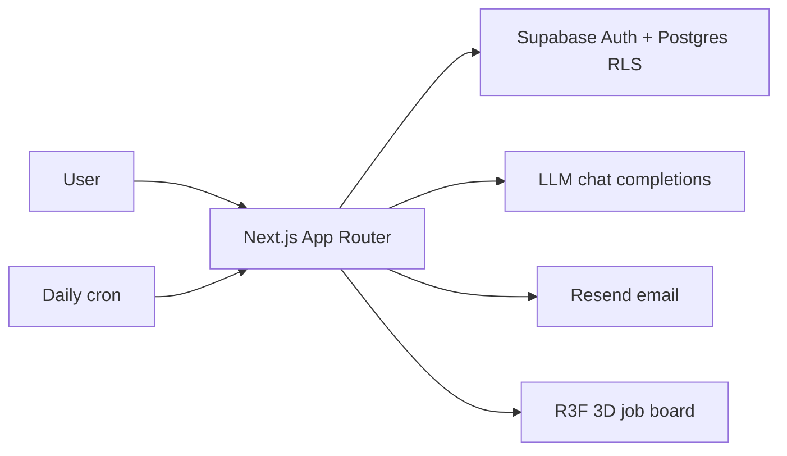

# PLAN — Rozgar Radar (MVP)

## Architecture

## Schema (Supabase)
- `profiles` id→auth.users, degree, branch, graduation_year, min_percentage, skills[], location
- `jobs` title, company, description, min_degree, allowed_branches[], grad_year_min/max, min_percentage, skills[], apply_url
- `job_matches` user_id, job_id, status(confirmed|likely|not_eligible|needs_review), reasons jsonb, explanation, score
- `saved_jobs` user_id, job_id
- RLS: jobs readable by anon+auth; profiles/matches/saved owner-scoped only

## Stage 1 — Backend
- scaffold: `package.json` `tsconfig.json` `next.config.ts` `postcss.config.mjs` `app/globals.css` `app/layout.tsx` `app/page.tsx` `middleware.ts`
- clients + db: `lib/supabase/client.ts` `lib/supabase/server.ts` `lib/env.ts` `supabase/schema.sql` `supabase/seed.sql` (20 mock jobs)
- api: `app/api/jobs/route.ts` (GET) `app/api/profile/route.ts` (GET+POST)
- auth ui: `app/login/page.tsx` `app/onboarding/page.tsx`

## Stage 2 — Eligibility AI
- `lib/llm.ts` (chat wrapper, JSON mode) `lib/rules.ts` (fixed degree/branch/year rules) `lib/matching.ts` (rules→LLM extract+explain→status)
- `app/api/match/route.ts` (POST) persists `job_matches`
- no API key ⇒ rules-only status, never crash

## Stage 3 — 3D scene
- `components/three/JobBoard.tsx` (Canvas, ring of cards, click→detail) `components/three/JobCard.tsx` (canvas-texture card, no HTML overlay) `components/three/AIOrb.tsx` (idle pulse / thinking spin / eligible green burst / not eligible red shake)
- `components/JobDetails.tsx` (overlay) `app/jobs/page.tsx` (+ list view of all roles)

## Stage 4 — Alerts + dashboard
- `lib/email.ts` (Resend) `lib/templates.ts` (HTML) `app/api/cron/daily-alerts/route.ts`
- `app/dashboard/page.tsx` (saved jobs, match status) `app/api/saved/route.ts` `app/api/auth/local/route.ts` `vercel.json` (cron 08:00 IST) `.env.example`

## Added during build
- `lib/data.ts` single data layer; `lib/local-store.ts` + `lib/mock-jobs.ts` file store so the app runs with no Supabase; `lib/config.ts` mode switch
- Env: `NEXT_PUBLIC_SUPABASE_URL` `NEXT_PUBLIC_SUPABASE_ANON_KEY` `SUPABASE_SERVICE_ROLE_KEY` `LLM_API_KEY` `LLM_BASE_URL` `LLM_MODEL` `RESEND_API_KEY` `EMAIL_FROM` `CRON_SECRET` `NEXT_PUBLIC_APP_URL`
